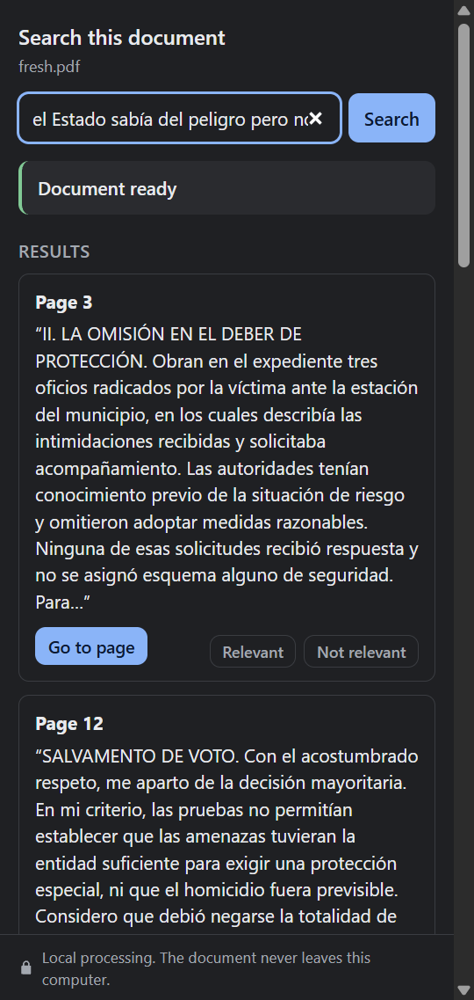
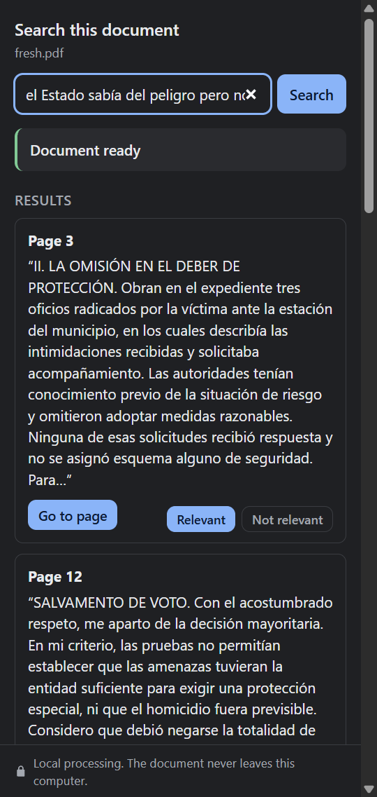
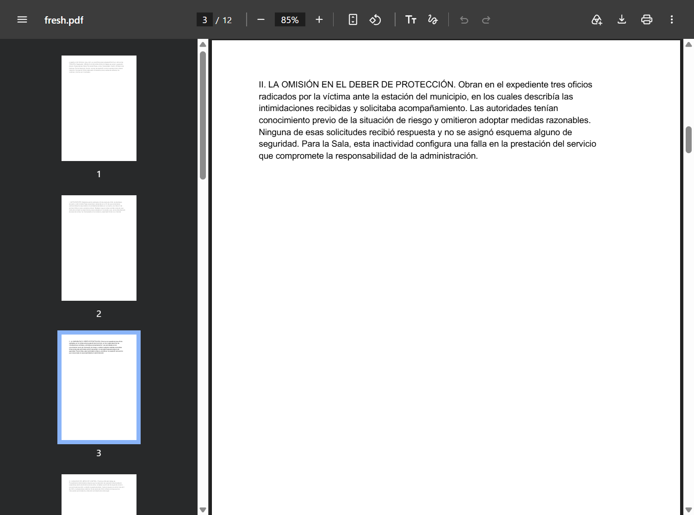
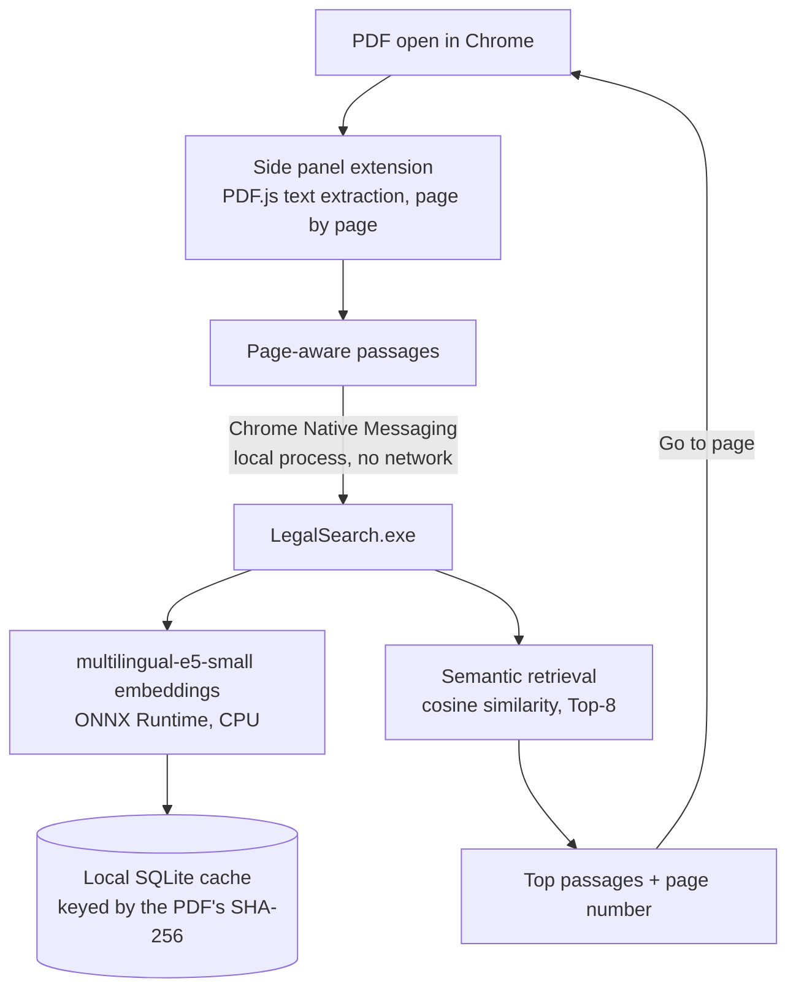

# LegalSearch

**Local semantic search for legal PDFs.**

Open a PDF in Google Chrome, describe what you are looking for in your own words, and LegalSearch shows the passages
that *mean* that — even when the document uses different words — with their page number and a button that takes
you straight to the page. Everything runs on your computer.

- **Semantic retrieval**: multilingual embeddings (multilingual-e5-small), not keyword matching
- **Local processing**: the document never leaves your computer
- **No paid APIs, no cloud processing, no accounts, no telemetry**
- **Windows + Google Chrome**, side panel next to Chrome's own PDF viewer
- **Page-aware results** with **click-to-page navigation**

> **Current status: 1.1.0 RC2 (release candidate)** · **Platform: Windows 10/11 x64 + Google Chrome**

> LegalSearch is a document retrieval tool. It does not provide legal advice, determine legal conclusions, or replace
> professional legal analysis.

## Screenshots

Real screenshots of the 1.1.0 release candidate, taken from the automated UI test (`scripts/e2e-chrome.mjs`) on the Spanish test
document. The query means *"the State knew about the danger but did nothing"*; the top result says *"the
authorities had prior knowledge of the risk and failed to adopt reasonable measures"* — no words in common.

| Semantic search in the side panel | Optional relevance feedback | "Go to page" opens the PDF at the result |
|---|---|---|
|  |  |  |

## Installation

1. Download `LegalSearchSetup.exe` and run it: **Next → Install → Finish**. No administrator rights are needed.
   The installer is not code-signed yet, so Windows may show *"Windows protected your PC"* → **More info → Run anyway**.
   Verify the download against `SHA256SUMS.txt` (`Get-FileHash .\LegalSearchSetup.exe`).
2. A guide opens to turn on the Chrome extension. **Until the extension is published in the Chrome Web Store, it is
   loaded manually**: `chrome://extensions` → *Developer mode* → *Load unpacked* →
   `%LOCALAPPDATA%\LegalSearch\extension`, then enable *Allow access to file URLs* for local PDFs.

Details: [docs/installation.md](docs/installation.md). Uninstall: *Windows Settings → Apps → LegalSearch → Uninstall*.

## Usage

1. Open a PDF in Chrome (from a website or from your computer).
2. Click the LegalSearch icon: the side panel opens. The first time a document is opened it is prepared locally
   (about 2 seconds per 100 pages); afterwards it is instant.
3. Type your query in natural language and press **Search**.
4. Click **Go to page** on a result.
5. Optionally mark results **Relevant** / **Not relevant**, report a **Missing result?**, and **Export evaluation
   data** to help measure search quality ([tester guide](docs/tester-guide.md)).

Scanned PDFs (images without a text layer) are detected but **not supported yet**: they need OCR first.

## How it works



The engine starts when the side panel opens and exits when it closes — no service, no background process, no open
ports. Architecture, protocol and design decisions: [docs/architecture.md](docs/architecture.md).

## Privacy

PDF contents, queries and embeddings stay on your computer. There is no telemetry, analytics, external AI API or user
account. Optional feedback is stored in your Chrome profile and leaves it only if you export it. Full details,
including exactly what is stored locally and what is sent over the network: [PRIVACY.md](PRIVACY.md).

## Performance

Measured on a Windows 11 laptop (4 inference threads), from the automated end-to-end tests:

| Metric | Value |
|---|---|
| Search latency (end to end, 300-page document) | ~3 ms |
| First indexing, 300 pages / 494 passages | ~6–7 s |
| Reopening an indexed document | ~5 ms |
| RAM: panel open without document / document ready / indexing peak | ~5 MB / ~165 MB / ~250 MB |
| Installer / installed size | ~89 MB / ~155 MB |

## Retrieval quality

Evaluated on 54 Spanish legal queries over two fictitious rulings (paraphrases, legal terms, article numbers, case
names, dates, names, file numbers), with queries written before looking at results:

| System | Recall@1 | Recall@3 | Recall@5 | MRR |
|---|---|---|---|---|
| **Dense (default)** | 87.0% | 92.6% | 98.1% | 0.913 |
| BM25 only | 74.1% | 81.5% | 83.3% | 0.792 |
| Hybrid dense + BM25 (experimental, off by default) | 90.7% | 92.6% | 98.1% | 0.929 |

These corpora are small; the release candidate collects real lawyer feedback before any ranking change. The hybrid
mode is available for evaluation only (`LEGALSEARCH_HYBRID=1`). See
[docs/architecture.md](docs/architecture.md#hybrid-retrieval-dense--bm25-rrf-implemented-off-by-default).

## Building from source

Requirements (build machine only): Rust (MSVC toolchain), Visual Studio Build Tools with C++, Node.js ≥ 20,
Inno Setup 6.

```powershell
powershell -ExecutionPolicy Bypass -File scripts\build-all.ps1
```

This downloads the pinned model and ONNX Runtime (verified by SHA-256), runs all automated tests and produces:

```
dist/
├── LegalSearchSetup.exe                 installer (engine + model + runtime + extension)
├── legalsearch-extension-store.zip      Chrome Web Store package
├── SHA256SUMS.txt
├── TESTER-GUIDE.md
└── extension/                           unpacked extension for "Load unpacked"
```

Development workflow, repository layout and publishing the extension: [CONTRIBUTING.md](CONTRIBUTING.md) and
[docs/installation.md](docs/installation.md).

## Testing

| Suite | Where it runs |
|---|---|
| Rust unit tests, real-model semantic and retrieval evaluation, tokenizer equivalence | CI + local |
| Extension unit tests (including real PDF.js extraction) | CI + local |
| Engine end-to-end over the Native Messaging protocol | CI + local |
| Dependency audits (`cargo audit`, `npm audit`) | CI |
| Chrome UI end-to-end (side panel, search, Go to page, feedback, export) | Local release validation |
| Clean install / uninstall verification | Local release validation |

Commands: [CONTRIBUTING.md](CONTRIBUTING.md#tests).

## Limitations

- Windows + Google Chrome only.
- Scanned PDFs require OCR, which is not included. Password-protected PDFs cannot be read.
- "Go to page" reloads the PDF tab (Chrome's viewer only honors `#page=N` on load), so the zoom level resets.
- The extension must be loaded manually (developer mode) until it is published in the Chrome Web Store.
- Binaries are not code-signed yet (SmartScreen warning; Smart App Control may block them).
- Retrieval quality has been measured on small evaluation sets; real-world feedback is being collected.

More: [docs/troubleshooting.md](docs/troubleshooting.md).

## Project status

`1.1.0 RC2` is a release candidate for testing with lawyers. Next steps: collect retrieval feedback, code signing,
Chrome Web Store publication, and OCR. Changes are tracked in [CHANGELOG.md](CHANGELOG.md).

Security reports: [SECURITY.md](SECURITY.md). Contributions: [CONTRIBUTING.md](CONTRIBUTING.md).

## License

LegalSearch is released under the [MIT License](LICENSE). It bundles third-party components under their own
licenses (MIT, Apache-2.0 and others); see [THIRD_PARTY_NOTICES.md](THIRD_PARTY_NOTICES.md).
